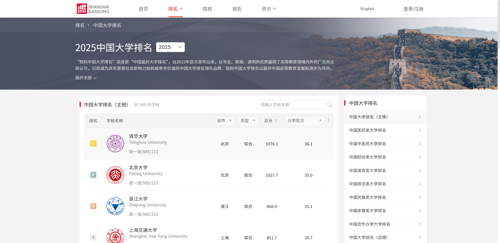
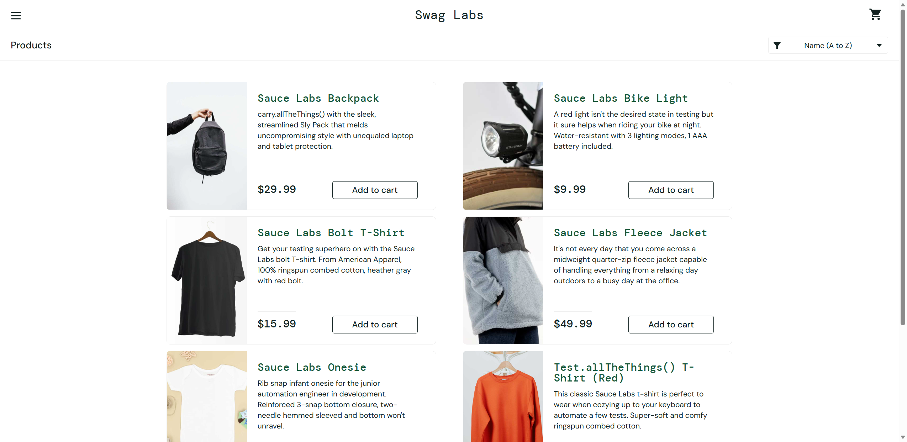

# 大数据采集与处理 · 实验4 动态网页爬取

本仓库是《大数据采集与处理》课程**实验4 动态网页爬取**的代码与数据，使用
**Python 3 + Selenium 4 + Microsoft Edge** 完成，对应实验要求的第（2）项和第（3）项：

| 任务 | 内容 | 结果 |
| --- | --- | --- |
| 任务二 | 利用 Selenium 模拟鼠标翻页，爬取[软科中国大学排名 2025](https://www.shanghairanking.cn/rankings/bcur/2025) | 20 页共 **589** 条，保存为 CSV + Excel |
| 任务三 | 利用 Selenium 自动登录演示站点，爬取商品信息并存储 | [saucedemo](https://www.saucedemo.com/) 登录成功，抓取 **6** 件商品 |

## 一、实验环境

- 操作系统：Windows 11 64 位
- 开发语言：Python 3.12.6
- 第三方库：selenium 4.54.0、openpyxl 3.1.5
- 浏览器：Microsoft Edge 158.0.4370.33
- 驱动：Microsoft Edge WebDriver 158.0.4370.33（路径 `D:\msedgedriver64\msedgedriver.exe`）
- 编辑器：PyCharm

## 二、项目结构

```
动态网页爬取/
├── ranking_spider.py     # 任务二：模拟鼠标翻页，爬取软科中国大学排名 2025
├── login_spider.py       # 任务三：自动登录 saucedemo 并抓取商品信息
├── spider_utils.py       # 公共模块：创建 Edge 驱动、保存 CSV/Excel、统计耗时
├── requirements.txt      # 依赖清单
├── data/                 # 运行后生成的数据文件与截图
│   ├── shanghai_ranking_2025.csv
│   ├── shanghai_ranking_2025.xlsx
│   ├── saucedemo_products.csv
│   ├── saucedemo_products.xlsx
│   └── login_success.png
└── README.md
```

## 三、运行方法

```bash
# 1. 安装依赖
pip install -r requirements.txt

# 2. 爬取软科中国大学排名（自动翻完 20 页，约 1 分钟）
python ranking_spider.py

# 3. 自动登录演示站点并抓取商品信息（约 5 秒）
python login_spider.py
```

> 如果 Edge 浏览器或驱动的路径与本机不同，修改 `spider_utils.py` 顶部的
> `EDGE_BINARY`、`EDGE_DRIVER` 两个常量即可；找不到自定义的 Edge 时，
> 程序会自动改用系统默认安装的 Edge。

## 四、实现要点

### 1. 为什么必须用 Selenium？

软科排名页面的数据不是写在 HTML 源码里的，而是页面加载后由 JavaScript 异步请求接口、
再动态渲染到 `<table>` 中，所以用 `requests` 只能拿到空表格。Selenium 驱动真实的 Edge
浏览器执行 JavaScript，等表格渲染完成后再解析，才能取到数据。

### 2. 显式等待，而不是死等

```python
WebDriverWait(driver, 20).until(
    EC.presence_of_element_located((By.CSS_SELECTOR, "table tbody tr"))
)
```

翻页时还额外等待“页码发生变化”：

```python
ActionChains(driver).move_to_element(next_btn).pause(0.2).click().perform()
WebDriverWait(driver, 20).until(lambda d: current_page_no(d) != old_page)
```

### 3. 用 ActionChains 模拟真实鼠标翻页

```python
driver.execute_script("arguments[0].scrollIntoView({block: 'center'});", next_btn)
ActionChains(driver).move_to_element(next_btn).pause(0.2).click().perform()
```

`move_to_element()` 先把鼠标移动到“下一页”按钮上，再 `click()`，与真人操作一致；
当按钮带有 `ant-pagination-disabled` 类时说明已经到了最后一页，结束循环。

### 4. 数据存储

`spider_utils.save_csv()` 用 `utf-8-sig` 编码写 CSV，Excel 双击打开不乱码；
`spider_utils.save_excel()` 用 openpyxl 写入 xlsx，并给表头加底色、自适应列宽、冻结首行。

## 五、运行结果

### 任务二：软科中国大学排名 2025（前 10 名）

| 排名 | 学校名称 | 英文名称 | 学校标签 | 省市 | 办学类型 | 总分 | 办学层次 |
| ---: | --- | --- | --- | --- | --- | ---: | ---: |
| 1 | 清华大学 | Tsinghua University | 双一流/985/211 | 北京 | 综合 | 1076.1 | 36.1 |
| 2 | 北京大学 | Peking University | 双一流/985/211 | 北京 | 综合 | 1027.7 | 35.0 |
| 3 | 浙江大学 | Zhejiang University | 双一流/985/211 | 浙江 | 综合 | 868.9 | 35.1 |
| 4 | 上海交通大学 | Shanghai Jiao Tong University | 双一流/985/211 | 上海 | 综合 | 851.7 | 35.7 |
| 5 | 复旦大学 | Fudan University | 双一流/985/211 | 上海 | 综合 | 788.4 | 36.8 |
| 6 | 南京大学 | Nanjing University | 双一流/985/211 | 江苏 | 综合 | 707.8 | 36.8 |
| 7 | 中国科学技术大学 | University of Science and Technology of China | 双一流/985/211 | 安徽 | 理工 | 637.0 | 40.0 |
| 8 | 武汉大学 | Wuhan University | 双一流/985/211 | 湖北 | 综合 | 629.2 | 33.8 |
| 9 | 华中科技大学 | Huazhong University of Science and Technology | 双一流/985/211 | 湖北 | 综合 | 628.9 | 32.8 |
| 10 | 西安交通大学 | Xi'an Jiaotong University | 双一流/985/211 | 陕西 | 综合 | 598.5 | 34.6 |

> 说明：软科对 500 名以后的学校统一显示为“500+”，脚本原样保留该文本，
> 因此 `排名` 列在 500 条之后是字符串 `500+`，`总分`、`办学层次` 为空。



### 任务三：登录成功后的商品列表



## 六、实验报告

完整的实验报告（含五张实验截图）见课程提交的 Word 文档。

## 七、说明

`saucedemo.com` 是 Sauce Labs 官方提供的公开练习站点，账号（standard_user / secret_sauce）
直接写在登录页上，不涉及任何个人隐私，仅用于练习自动化登录流程。
